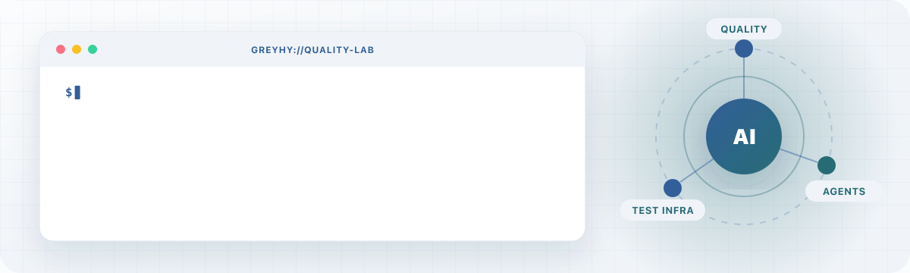

<!-- Generated by node scripts/generate-profile.mjs. Edit content in that script, then regenerate. -->
<picture>
  <source media="(prefers-reduced-motion: reduce) and (max-width: 1100px) and (prefers-color-scheme: dark)" srcset="assets/profile-header-mobile-dark-743814e353.svg" />
  <source media="(prefers-reduced-motion: reduce) and (max-width: 1100px)" srcset="assets/profile-header-mobile-light-dbcc5ac708.svg" />
  <source media="(prefers-reduced-motion: reduce) and (prefers-color-scheme: dark)" srcset="assets/profile-header-dark-f45062f6af.svg" />
  <source media="(prefers-reduced-motion: reduce)" srcset="assets/profile-header-light-8baba9ee5e.svg" />
  <source media="(max-width: 1100px) and (prefers-color-scheme: dark)" srcset="assets/profile-header-mobile-dark-animated-10e082c8a5.gif" />
  <source media="(max-width: 1100px)" srcset="assets/profile-header-mobile-light-animated-99492617cb.gif" />
  <source media="(prefers-color-scheme: dark)" srcset="assets/profile-header-dark-animated-dea5134048.gif" />
  
</picture>

  <a href="https://hankhuang.top"><b>Blog ↗</b></a> &nbsp; · &nbsp;
  <a href="https://docs.hankhuang.top"><b>Engineering Notes ↗</b></a> &nbsp; · &nbsp;
  <a href="https://hankhuang.top/analytics/overview/"><b>Observability ↗</b></a> &nbsp; · &nbsp;
  <a href="https://hankhuang.top/?ask=1"><b>Personal Agent ↗</b></a>

### 04 / Notes · 写作与思考

- [工程文档](https://docs.hankhuang.top)：记录测试平台、自动化与 AI / Agent 项目中的实现方法。
- [Thinking And Talk](https://hankhuang.top/#thinking)：关于工程实践、职业选择与 AI Agent 时代的成长。

  
<b>GitHub 活动与语言统计</b>

   
  

---

  欢迎交流工程实践与项目合作：<a href="mailto:hank.huang.it@gmail.com">hank.huang.it@gmail.com</a>

