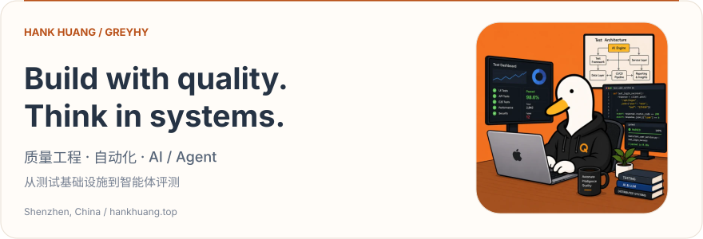
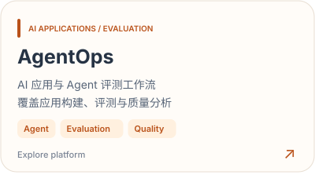
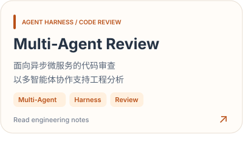
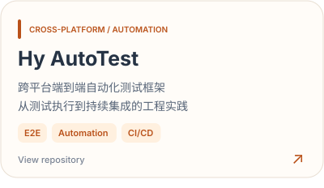
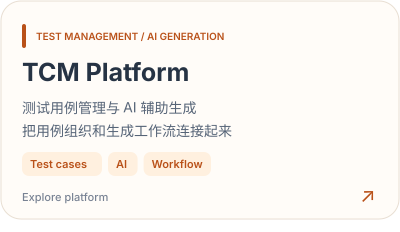
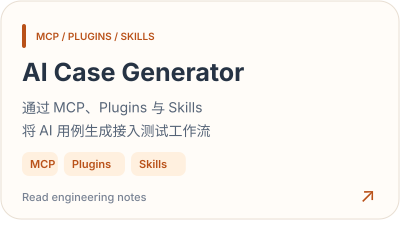
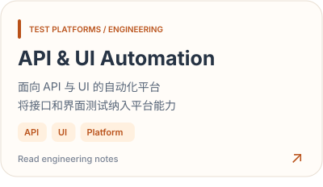
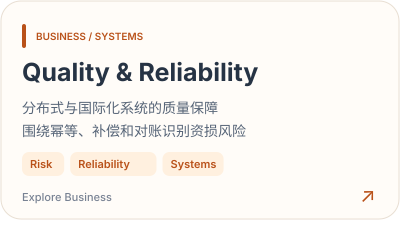
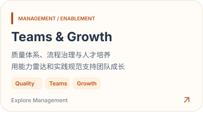

<!-- Generated by node scripts/generate-profile.mjs. Edit content in that script, then regenerate. -->
<picture>
  <source media="(max-width: 1100px) and (prefers-color-scheme: dark)" srcset="assets/profile-header-mobile-dark-9d627bd212.svg" />
  <source media="(max-width: 1100px)" srcset="assets/profile-header-mobile-light-e25810529b.svg" />
  <source media="(prefers-color-scheme: dark)" srcset="assets/profile-header-dark-24acd7b470.svg" />
  
</picture>

  <a href="https://hankhuang.top"><b>Portfolio ↗</b></a> &nbsp; · &nbsp;
  <a href="https://docs.hankhuang.top"><b>Engineering Notes ↗</b></a> &nbsp; · &nbsp;
  <a href="https://github.com/GreyHy?tab=repositories"><b>Repositories ↗</b></a> &nbsp; · &nbsp;
  <a href="mailto:hank.huang.it@gmail.com"><b>Email ↗</b></a>

你好，我是 **Hank Huang / GreyHy**，目前在 **深圳，中国**。我关注质量工程与工程效能，围绕测试基础设施、跨平台自动化，以及 AI / Agent 评测与可靠性开展实践，并在[个人网站](https://hankhuang.top)与[工程文档](https://docs.hankhuang.top)中记录项目和思考。

### 01 / Projects · 项目实践

**AI / Agent**

<a href="https://agentops.hankhuang.top/#carousel"><picture>
  <source media="(max-width: 1100px) and (prefers-color-scheme: dark)" srcset="assets/project-agentops-mobile-dark-b92c0e1161.svg" />
  <source media="(max-width: 1100px)" srcset="assets/project-agentops-mobile-light-771964cb83.svg" />
  <source media="(prefers-color-scheme: dark)" srcset="assets/project-agentops-dark-690492d580.svg" />
  
</picture></a>
<a href="https://docs.hankhuang.top/Tech/multi-agent-code-review/overview"><picture>
  <source media="(max-width: 1100px) and (prefers-color-scheme: dark)" srcset="assets/project-agent-review-mobile-dark-6bd7c121c7.svg" />
  <source media="(max-width: 1100px)" srcset="assets/project-agent-review-mobile-light-bca6fbdd21.svg" />
  <source media="(prefers-color-scheme: dark)" srcset="assets/project-agent-review-dark-b3127f0458.svg" />
  
</picture></a>

**Test platforms & automation**

<a href="https://github.com/GreyHy/Hy-AutoTest-Framework"><picture>
  <source media="(max-width: 1100px) and (prefers-color-scheme: dark)" srcset="assets/project-automation-mobile-dark-b8a1318126.svg" />
  <source media="(max-width: 1100px)" srcset="assets/project-automation-mobile-light-0b49fc53f9.svg" />
  <source media="(prefers-color-scheme: dark)" srcset="assets/project-automation-dark-fbee58a0e6.svg" />
  
</picture></a>
<a href="https://hy-tcm.hankhuang.top/"><picture>
  <source media="(max-width: 1100px) and (prefers-color-scheme: dark)" srcset="assets/project-tcm-mobile-dark-a135bb48cf.svg" />
  <source media="(max-width: 1100px)" srcset="assets/project-tcm-mobile-light-b62c1e01dc.svg" />
  <source media="(prefers-color-scheme: dark)" srcset="assets/project-tcm-dark-f41ac2f6b3.svg" />
  
</picture></a>

<a href="https://docs.hankhuang.top/Tech/tcm-case-management-ai-generation/ai-generation"><picture>
  <source media="(max-width: 1100px) and (prefers-color-scheme: dark)" srcset="assets/project-ai-cases-mobile-dark-3b2f99bb4d.svg" />
  <source media="(max-width: 1100px)" srcset="assets/project-ai-cases-mobile-light-0802fbc5c2.svg" />
  <source media="(prefers-color-scheme: dark)" srcset="assets/project-ai-cases-dark-44f40ea50b.svg" />
  
</picture></a>
<a href="https://docs.hankhuang.top/Tech/api-ui-automation/overview"><picture>
  <source media="(max-width: 1100px) and (prefers-color-scheme: dark)" srcset="assets/project-api-ui-mobile-dark-9203fb6875.svg" />
  <source media="(max-width: 1100px)" srcset="assets/project-api-ui-mobile-light-9d5af22558.svg" />
  <source media="(prefers-color-scheme: dark)" srcset="assets/project-api-ui-dark-71392a1d77.svg" />
  
</picture></a>

  
<b>展开项目文字版与入口</b>

| 项目 | 方向 | 入口 |
| :--- | :--- | :--- |
| **AgentOps** | AI 应用与评测平台 | [Explore platform](https://agentops.hankhuang.top/#carousel) |
| **Multi-Agent Review** | 异步微服务的多智能体代码审查 | [Read engineering notes](https://docs.hankhuang.top/Tech/multi-agent-code-review/overview) |
| **Hy AutoTest** | 跨平台端到端自动化测试框架 | [View repository](https://github.com/GreyHy/Hy-AutoTest-Framework) |
| **TCM Platform** | 测试用例管理与 AI 辅助生成 | [Explore platform](https://hy-tcm.hankhuang.top/) |
| **AI Case Generator** | MCP / Plugins / Skills 用例生成 | [Read engineering notes](https://docs.hankhuang.top/Tech/tcm-case-management-ai-generation/ai-generation) |
| **API & UI Automation** | API 与 UI 自动化平台 | [Read engineering notes](https://docs.hankhuang.top/Tech/api-ui-automation/overview) |
| CampusBBS | Spring Boot 项目 | [Repository](https://github.com/GreyHy/CampusBBS-SpringBoot-) |

项目卡片分别链接到可访问的平台、公开仓库或工程文档；更多项目可见 [Portfolio](https://hankhuang.top/#projects)。

### 02 / Practice · 业务与团队

<a href="https://hankhuang.top/#business"><picture>
  <source media="(max-width: 1100px) and (prefers-color-scheme: dark)" srcset="assets/project-quality-mobile-dark-2839e7509b.svg" />
  <source media="(max-width: 1100px)" srcset="assets/project-quality-mobile-light-bb65245d2c.svg" />
  <source media="(prefers-color-scheme: dark)" srcset="assets/project-quality-dark-708c5d30d8.svg" />
  
</picture></a>
<a href="https://hankhuang.top/#management"><picture>
  <source media="(max-width: 1100px) and (prefers-color-scheme: dark)" srcset="assets/project-teams-mobile-dark-6e20ebc957.svg" />
  <source media="(max-width: 1100px)" srcset="assets/project-teams-mobile-light-89ef2529df.svg" />
  <source media="(prefers-color-scheme: dark)" srcset="assets/project-teams-dark-03cf905738.svg" />
  
</picture></a>

我关注业务链路中的风险识别与质量保障，也整理质量体系、团队能力建设与工程规范的实践。在 AI / Agent 评测中，重点关注回归集与 BadCase、分级质量指标，以及规则评分、LLM Judge 和人工校准的配合。

### 03 / Toolkit · 常用工具与技术方向

**Quality engineering**

<picture>
  <source media="(prefers-color-scheme: dark)" srcset="assets/tool-selenium-dark-db0c928563.svg" />
  
</picture>
<picture>
  <source media="(prefers-color-scheme: dark)" srcset="assets/tool-pytest-dark-b09169423f.svg" />
  
</picture>
<picture>
  <source media="(prefers-color-scheme: dark)" srcset="assets/tool-jenkins-dark-7f3e831c5f.svg" />
  
</picture>
<picture>
  <source media="(prefers-color-scheme: dark)" srcset="assets/tool-api-ui-dark-ca1455c172.svg" />
  
</picture>
<picture>
  <source media="(prefers-color-scheme: dark)" srcset="assets/tool-performance-dark-e1325b11a6.svg" />
  
</picture>

**AI / Agent**

<picture>
  <source media="(prefers-color-scheme: dark)" srcset="assets/tool-mcp-dark-1f1e321f99.svg" />
  
</picture>
<picture>
  <source media="(prefers-color-scheme: dark)" srcset="assets/tool-multi-agent-dark-c429c0d85d.svg" />
  
</picture>
<picture>
  <source media="(prefers-color-scheme: dark)" srcset="assets/tool-agent-harness-dark-c0d7c732b4.svg" />
  
</picture>
<picture>
  <source media="(prefers-color-scheme: dark)" srcset="assets/tool-rag-dark-54a86e9388.svg" />
  
</picture>
<picture>
  <source media="(prefers-color-scheme: dark)" srcset="assets/tool-agent-eval-dark-d8671fa0cf.svg" />
  
</picture>

**Languages & systems**

<picture>
  <source media="(prefers-color-scheme: dark)" srcset="assets/tool-python-dark-40151c87f2.svg" />
  
</picture>
<picture>
  <source media="(prefers-color-scheme: dark)" srcset="assets/tool-java-dark-9ed3b12800.svg" />
  
</picture>
<picture>
  <source media="(prefers-color-scheme: dark)" srcset="assets/tool-go-dark-1a016f62c0.svg" />
  
</picture>
<picture>
  <source media="(prefers-color-scheme: dark)" srcset="assets/tool-linux-dark-5a6cc417bd.svg" />
  
</picture>
<picture>
  <source media="(prefers-color-scheme: dark)" srcset="assets/tool-mysql-dark-44da4c2438.svg" />
  
</picture>
<picture>
  <source media="(prefers-color-scheme: dark)" srcset="assets/tool-redis-dark-f99c3fb840.svg" />
  
</picture>
<picture>
  <source media="(prefers-color-scheme: dark)" srcset="assets/tool-elasticsearch-dark-62a75d00bd.svg" />
  
</picture>
<picture>
  <source media="(prefers-color-scheme: dark)" srcset="assets/tool-git-dark-35d1f7ed9a.svg" />
  
</picture>

### 04 / Notes · 写作与思考

- [工程文档](https://docs.hankhuang.top)：记录测试平台、自动化与 AI / Agent 项目中的实现方法。
- [Thinking And Talk](https://hankhuang.top/#thinking)：关于工程实践、职业选择与 AI Agent 时代的成长。
- [Management](https://hankhuang.top/#management)：质量体系、团队能力评估与人才培养。

  
<b>GitHub 活动与语言统计</b>

   
  

---

  <b>Quality engineering · Test infrastructure · AI / Agent</b> 
  欢迎交流工程实践与项目合作：<a href="mailto:hank.huang.it@gmail.com">hank.huang.it@gmail.com</a>

