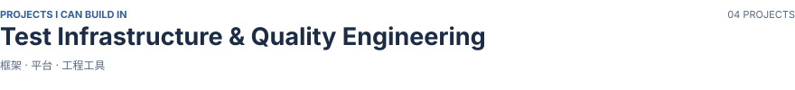
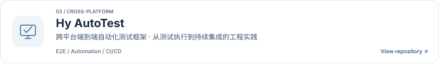
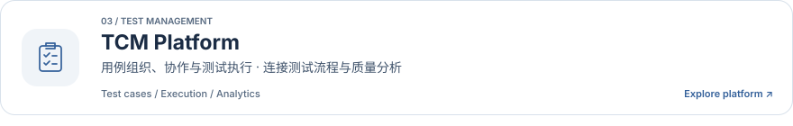
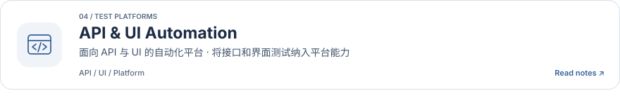
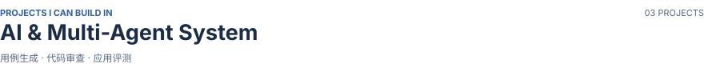
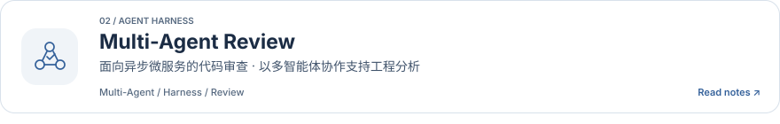
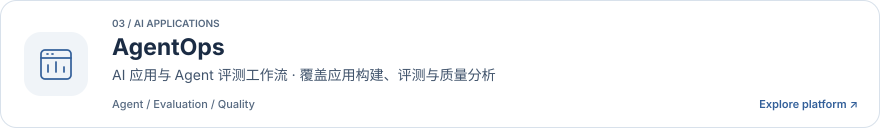
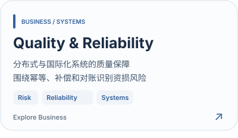
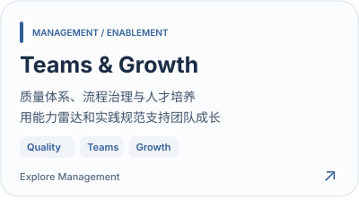

<!-- Generated by node scripts/generate-profile.mjs. Edit content in that script, then regenerate. -->
<picture>
  <source media="(prefers-reduced-motion: reduce) and (max-width: 1100px) and (prefers-color-scheme: dark)" srcset="assets/profile-header-mobile-dark-743814e353.svg" />
  <source media="(prefers-reduced-motion: reduce) and (max-width: 1100px)" srcset="assets/profile-header-mobile-light-dbcc5ac708.svg" />
  <source media="(prefers-reduced-motion: reduce) and (prefers-color-scheme: dark)" srcset="assets/profile-header-dark-f45062f6af.svg" />
  <source media="(prefers-reduced-motion: reduce)" srcset="assets/profile-header-light-8baba9ee5e.svg" />
  <source media="(max-width: 1100px) and (prefers-color-scheme: dark)" srcset="assets/profile-header-mobile-dark-animated-10e082c8a5.gif" />
  <source media="(max-width: 1100px)" srcset="assets/profile-header-mobile-light-animated-99492617cb.gif" />
  <source media="(prefers-color-scheme: dark)" srcset="assets/profile-header-dark-animated-dea5134048.gif" />
  
</picture>

  <a href="https://hankhuang.top"><b>Blog ↗</b></a> &nbsp; · &nbsp;
  <a href="https://docs.hankhuang.top"><b>Engineering Notes ↗</b></a> &nbsp; · &nbsp;
  <a href="https://hankhuang.top/analytics/overview/"><b>Observability ↗</b></a> &nbsp; · &nbsp;
  <a href="https://hankhuang.top/?ask=1"><b>Personal Agent ↗</b></a>

你好，我是 **Hank Huang / GreyHy**，在深圳从事测试开发。这里记录我在**测试基础设施与质量工程**、**AI 与多智能体系统**中的项目与实践。

<picture>
  <source media="(prefers-color-scheme: dark)" srcset="assets/profile-status-location-shopee-dark-e41278ce34.svg" />
  
</picture>
<picture>
  <source media="(prefers-color-scheme: dark)" srcset="assets/profile-status-transwarp-dark-f39a113193.svg" />
  
</picture>
<picture>
  <source media="(prefers-color-scheme: dark)" srcset="assets/profile-status-education-dark-2ffb99569a.svg" />
  
</picture>

### 01 / Projects · 项目实践

<picture>
  <source media="(max-width: 600px) and (prefers-color-scheme: dark)" srcset="assets/project-group-test-infra-mobile-dark-a4ad48e492.svg" />
  <source media="(max-width: 600px)" srcset="assets/project-group-test-infra-mobile-light-9f9c8c9efa.svg" />
  <source media="(prefers-color-scheme: dark)" srcset="assets/project-group-test-infra-dark-cf2a813111.svg" />
  
</picture>

<a href="https://docs.hankhuang.top/Tech/multi-agent-code-review/%E6%A0%B8%E5%BF%83%E5%AE%9E%E7%8E%B0%EF%BC%9A%E5%BE%AE%E6%9C%8D%E5%8A%A1%E4%BB%93%E5%BA%93%E5%B9%B6%E5%8F%91%E6%8B%89%E5%8F%96%E3%80%81%E9%87%8D%E8%AF%95%E4%B8%8E%E5%8F%AF%E8%A7%82%E6%B5%8B%E6%80%A7"><picture>
  <source media="(max-width: 600px) and (prefers-color-scheme: dark)" srcset="assets/project-repo-fetcher-mobile-dark-338be2d404.svg" />
  <source media="(max-width: 600px)" srcset="assets/project-repo-fetcher-mobile-light-91a9d92a04.svg" />
  <source media="(prefers-color-scheme: dark)" srcset="assets/project-repo-fetcher-dark-3e9dfc54f4.svg" />
  
</picture></a>

<a href="https://github.com/GreyHy/Hy-AutoTest-Framework"><picture>
  <source media="(max-width: 600px) and (prefers-color-scheme: dark)" srcset="assets/project-automation-mobile-dark-9ca2211ce9.svg" />
  <source media="(max-width: 600px)" srcset="assets/project-automation-mobile-light-1bf392fe11.svg" />
  <source media="(prefers-color-scheme: dark)" srcset="assets/project-automation-dark-d2cecedbc6.svg" />
  
</picture></a>

<a href="https://hy-tcm.hankhuang.top/"><picture>
  <source media="(max-width: 600px) and (prefers-color-scheme: dark)" srcset="assets/project-tcm-mobile-dark-386c92d6d3.svg" />
  <source media="(max-width: 600px)" srcset="assets/project-tcm-mobile-light-16410ffd49.svg" />
  <source media="(prefers-color-scheme: dark)" srcset="assets/project-tcm-dark-3f2c4be90a.svg" />
  
</picture></a>

<a href="https://docs.hankhuang.top/Tech/api-ui-automation/overview"><picture>
  <source media="(max-width: 600px) and (prefers-color-scheme: dark)" srcset="assets/project-api-ui-mobile-dark-72a88c7ebd.svg" />
  <source media="(max-width: 600px)" srcset="assets/project-api-ui-mobile-light-9f1865bc90.svg" />
  <source media="(prefers-color-scheme: dark)" srcset="assets/project-api-ui-dark-47e49fd123.svg" />
  
</picture></a>

<picture>
  <source media="(max-width: 600px) and (prefers-color-scheme: dark)" srcset="assets/project-group-ai-agents-mobile-dark-be35e864c5.svg" />
  <source media="(max-width: 600px)" srcset="assets/project-group-ai-agents-mobile-light-d79842afdb.svg" />
  <source media="(prefers-color-scheme: dark)" srcset="assets/project-group-ai-agents-dark-44010c2214.svg" />
  
</picture>

<a href="https://docs.hankhuang.top/Tech/tcm-case-management-ai-generation/ai-generation"><picture>
  <source media="(max-width: 600px) and (prefers-color-scheme: dark)" srcset="assets/project-ai-cases-mobile-dark-73fca95550.svg" />
  <source media="(max-width: 600px)" srcset="assets/project-ai-cases-mobile-light-e7fd7bcccc.svg" />
  <source media="(prefers-color-scheme: dark)" srcset="assets/project-ai-cases-dark-7670c1131a.svg" />
  
</picture></a>

<a href="https://docs.hankhuang.top/Tech/multi-agent-code-review/overview"><picture>
  <source media="(max-width: 600px) and (prefers-color-scheme: dark)" srcset="assets/project-agent-review-mobile-dark-73fffaec9c.svg" />
  <source media="(max-width: 600px)" srcset="assets/project-agent-review-mobile-light-725445c13f.svg" />
  <source media="(prefers-color-scheme: dark)" srcset="assets/project-agent-review-dark-4691facb32.svg" />
  
</picture></a>

<a href="https://agentops.hankhuang.top/#carousel"><picture>
  <source media="(max-width: 600px) and (prefers-color-scheme: dark)" srcset="assets/project-agentops-mobile-dark-438519d7c2.svg" />
  <source media="(max-width: 600px)" srcset="assets/project-agentops-mobile-light-f0cfe123f0.svg" />
  <source media="(prefers-color-scheme: dark)" srcset="assets/project-agentops-dark-19079bac28.svg" />
  
</picture></a>

  
<b>展开项目文字版与入口</b>

| 项目 | 方向 | 入口 |
| :--- | :--- | :--- |
| **Repository Fetcher** | 微服务仓库并发拉取工具 | [Read engineering notes](https://docs.hankhuang.top/Tech/multi-agent-code-review/%E6%A0%B8%E5%BF%83%E5%AE%9E%E7%8E%B0%EF%BC%9A%E5%BE%AE%E6%9C%8D%E5%8A%A1%E4%BB%93%E5%BA%93%E5%B9%B6%E5%8F%91%E6%8B%89%E5%8F%96%E3%80%81%E9%87%8D%E8%AF%95%E4%B8%8E%E5%8F%AF%E8%A7%82%E6%B5%8B%E6%80%A7) |
| **Hy AutoTest** | 跨平台端到端自动化测试框架 | [View repository](https://github.com/GreyHy/Hy-AutoTest-Framework) |
| **TCM Platform** | 测试用例管理与执行平台 | [Explore platform](https://hy-tcm.hankhuang.top/) |
| **API & UI Automation** | API 与 UI 自动化平台 | [Read engineering notes](https://docs.hankhuang.top/Tech/api-ui-automation/overview) |
| **AI Case Generator** | MCP / Plugins / Skills 用例生成 | [Read engineering notes](https://docs.hankhuang.top/Tech/tcm-case-management-ai-generation/ai-generation) |
| **Multi-Agent Review** | 异步微服务的多智能体代码审查 | [Read engineering notes](https://docs.hankhuang.top/Tech/multi-agent-code-review/overview) |
| **AgentOps** | AI 应用与评测平台 | [Explore platform](https://agentops.hankhuang.top/#carousel) |

### 02 / Practice · 业务与团队

<a href="https://hankhuang.top/#business"><picture>
  <source media="(max-width: 1100px) and (prefers-color-scheme: dark)" srcset="assets/project-quality-mobile-dark-fec0df0bc3.svg" />
  <source media="(max-width: 1100px)" srcset="assets/project-quality-mobile-light-72a61454ac.svg" />
  <source media="(prefers-color-scheme: dark)" srcset="assets/project-quality-dark-f54970350e.svg" />
  
</picture></a>
<a href="https://hankhuang.top/#management"><picture>
  <source media="(max-width: 1100px) and (prefers-color-scheme: dark)" srcset="assets/project-teams-mobile-dark-7422719618.svg" />
  <source media="(max-width: 1100px)" srcset="assets/project-teams-mobile-light-446fdfbbbc.svg" />
  <source media="(prefers-color-scheme: dark)" srcset="assets/project-teams-dark-21817276f1.svg" />
  
</picture></a>

从业务链路的风险识别、幂等与补偿校验，到质量规范和团队能力建设；AI / Agent 评测侧关注回归集、BadCase，以及规则评分、LLM Judge 与人工校准。

### 03 / Toolkit · 常用工具与技术方向

**Quality engineering**

<picture>
  <source media="(prefers-color-scheme: dark)" srcset="assets/tool-selenium-dark-229039e428.svg" />
  
</picture>
<picture>
  <source media="(prefers-color-scheme: dark)" srcset="assets/tool-pytest-dark-935a468cf4.svg" />
  
</picture>
<picture>
  <source media="(prefers-color-scheme: dark)" srcset="assets/tool-jenkins-dark-4b583e02e7.svg" />
  
</picture>
<picture>
  <source media="(prefers-color-scheme: dark)" srcset="assets/tool-jmeter-dark-65e695a581.svg" />
  
</picture>
<picture>
  <source media="(prefers-color-scheme: dark)" srcset="assets/tool-locust-dark-b2e4590590.svg" />
  
</picture>
<picture>
  <source media="(prefers-color-scheme: dark)" srcset="assets/tool-playwright-dark-3751bd6b80.svg" />
  
</picture>
<picture>
  <source media="(prefers-color-scheme: dark)" srcset="assets/tool-appium-dark-42bea23fe3.svg" />
  
</picture>
<picture>
  <source media="(prefers-color-scheme: dark)" srcset="assets/tool-docker-dark-07ef588efb.svg" />
  
</picture>
<picture>
  <source media="(prefers-color-scheme: dark)" srcset="assets/tool-kubernetes-dark-5d2943f7e3.svg" />
  
</picture>
<picture>
  <source media="(prefers-color-scheme: dark)" srcset="assets/tool-api-ui-dark-15cda3d8c6.svg" />
  
</picture>
<picture>
  <source media="(prefers-color-scheme: dark)" srcset="assets/tool-performance-dark-8c5420e2c3.svg" />
  
</picture>

**AI / Agent**

<picture>
  <source media="(prefers-color-scheme: dark)" srcset="assets/tool-mcp-dark-88b36857be.svg" />
  
</picture>
<picture>
  <source media="(prefers-color-scheme: dark)" srcset="assets/tool-multi-agent-dark-18879911a4.svg" />
  
</picture>
<picture>
  <source media="(prefers-color-scheme: dark)" srcset="assets/tool-agent-harness-dark-7657d7aab0.svg" />
  
</picture>
<picture>
  <source media="(prefers-color-scheme: dark)" srcset="assets/tool-rag-dark-d082d8c10a.svg" />
  
</picture>
<picture>
  <source media="(prefers-color-scheme: dark)" srcset="assets/tool-agent-eval-dark-76398bcfb2.svg" />
  
</picture>
<picture>
  <source media="(prefers-color-scheme: dark)" srcset="assets/tool-context-management-dark-fca4c8d4ad.svg" />
  
</picture>

**Languages & systems**

<picture>
  <source media="(prefers-color-scheme: dark)" srcset="assets/tool-python-dark-34fefa7d8c.svg" />
  
</picture>
<picture>
  <source media="(prefers-color-scheme: dark)" srcset="assets/tool-java-dark-fde50dbaf8.svg" />
  
</picture>
<picture>
  <source media="(prefers-color-scheme: dark)" srcset="assets/tool-go-dark-d1ffa721c4.svg" />
  
</picture>
<picture>
  <source media="(prefers-color-scheme: dark)" srcset="assets/tool-linux-dark-6c2b4ee52c.svg" />
  
</picture>
<picture>
  <source media="(prefers-color-scheme: dark)" srcset="assets/tool-mysql-dark-67557c94cc.svg" />
  
</picture>
<picture>
  <source media="(prefers-color-scheme: dark)" srcset="assets/tool-redis-dark-c594f4cf4a.svg" />
  
</picture>
<picture>
  <source media="(prefers-color-scheme: dark)" srcset="assets/tool-git-dark-290c301a82.svg" />
  
</picture>
<picture>
  <source media="(prefers-color-scheme: dark)" srcset="assets/tool-microservices-dark-edd7eb2f77.svg" />
  
</picture>
<picture>
  <source media="(prefers-color-scheme: dark)" srcset="assets/tool-kafka-dark-28e6e7d3a0.svg" />
  
</picture>
<picture>
  <source media="(prefers-color-scheme: dark)" srcset="assets/tool-vue-dark-0403409e60.svg" />
  
</picture>
<picture>
  <source media="(prefers-color-scheme: dark)" srcset="assets/tool-react-dark-1ae78a9616.svg" />
  
</picture>

**Observability · 可观测**

<picture>
  <source media="(prefers-color-scheme: dark)" srcset="assets/tool-prometheus-dark-e33b314d04.svg" />
  
</picture>
<picture>
  <source media="(prefers-color-scheme: dark)" srcset="assets/tool-grafana-dark-98f141d755.svg" />
  
</picture>
<picture>
  <source media="(prefers-color-scheme: dark)" srcset="assets/tool-opentelemetry-dark-592e9319f3.svg" />
  
</picture>
<picture>
  <source media="(prefers-color-scheme: dark)" srcset="assets/tool-ebpf-dark-4ee220cb5f.svg" />
  
</picture>
<picture>
  <source media="(prefers-color-scheme: dark)" srcset="assets/tool-elasticsearch-dark-bd7d57d281.svg" />
  
</picture>
<picture>
  <source media="(prefers-color-scheme: dark)" srcset="assets/tool-clickhouse-dark-9904193833.svg" />
  
</picture>

### 04 / Notes · 写作与思考

- [工程文档](https://docs.hankhuang.top)：记录测试平台、自动化与 AI / Agent 项目中的实现方法。
- [Thinking And Talk](https://hankhuang.top/#thinking)：关于工程实践、职业选择与 AI Agent 时代的成长。

  
<b>GitHub 活动与语言统计</b>

   
  

---

  欢迎交流工程实践与项目合作：<a href="mailto:hank.huang.it@gmail.com">hank.huang.it@gmail.com</a>

