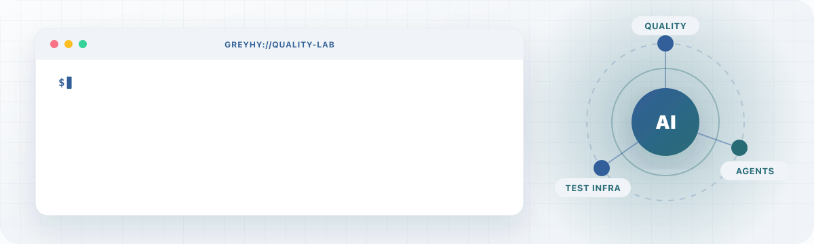

<!-- Generated by node scripts/generate-profile.mjs. Edit content in that script, then regenerate. -->
<picture>
  <source media="(prefers-reduced-motion: reduce) and (max-width: 1100px) and (prefers-color-scheme: dark)" srcset="assets/profile-header-mobile-dark-743814e353.svg" />
  <source media="(prefers-reduced-motion: reduce) and (max-width: 1100px)" srcset="assets/profile-header-mobile-light-dbcc5ac708.svg" />
  <source media="(prefers-reduced-motion: reduce) and (prefers-color-scheme: dark)" srcset="assets/profile-header-dark-f45062f6af.svg" />
  <source media="(prefers-reduced-motion: reduce)" srcset="assets/profile-header-light-8baba9ee5e.svg" />
  <source media="(max-width: 1100px) and (prefers-color-scheme: dark)" srcset="assets/profile-header-mobile-dark-animated-10e082c8a5.gif" />
  <source media="(max-width: 1100px)" srcset="assets/profile-header-mobile-light-animated-99492617cb.gif" />
  <source media="(prefers-color-scheme: dark)" srcset="assets/profile-header-dark-animated-dea5134048.gif" />
  
</picture>

  <a href="https://hankhuang.top"><b>Blog ↗</b></a> &nbsp; · &nbsp;
  <a href="https://docs.hankhuang.top"><b>Engineering Notes ↗</b></a> &nbsp; · &nbsp;
  <a href="https://hankhuang.top/analytics/detail/?site=all&days=30#requests"><b>Observability ↗</b></a> &nbsp; · &nbsp;
  <a href="https://hankhuang.top/?ask=1"><b>Personal Agent ↗</b></a>

### Notes · Thinking And Talk

- [AI-Agent时代的成长之路](https://docs.hankhuang.top/thinking/career-growth-in-the-ai-agent-era)：个人面对AI-Agent时代，关于工程实践、职业选择与 AI Agent 时代成长的思考、决策、认知。
- [五年成长复盘：技术、业务与管理](https://docs.hankhuang.top/articles/past-5-years-growth-and-review/)：关于个人五年在技术、业务与管理侧的成长复盘。

For collaboration or technical discussions, feel free to contact me at **`hank.huang.it@gmail.com`**.  

###

<h2 align="left">  Github Statistics</h2>

###

<!-- 

    
    
    
  

 -->

<!-- ## Metrics
 

 

<h2 align="left">  Github Statistics</h2>
    -->

###

  

